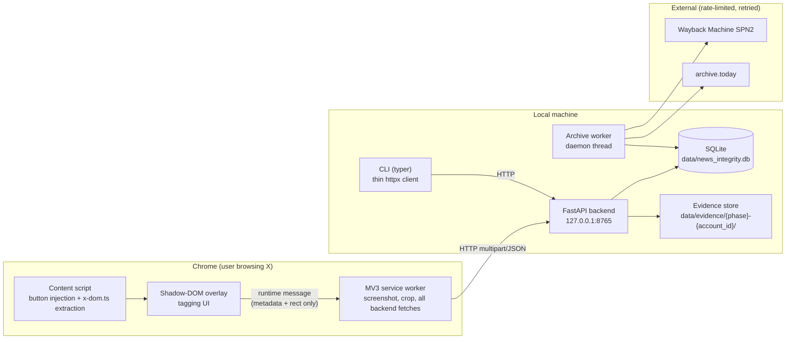
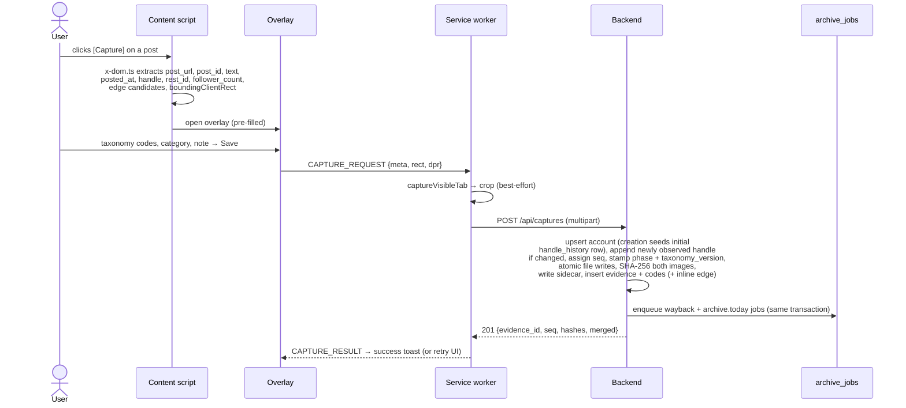
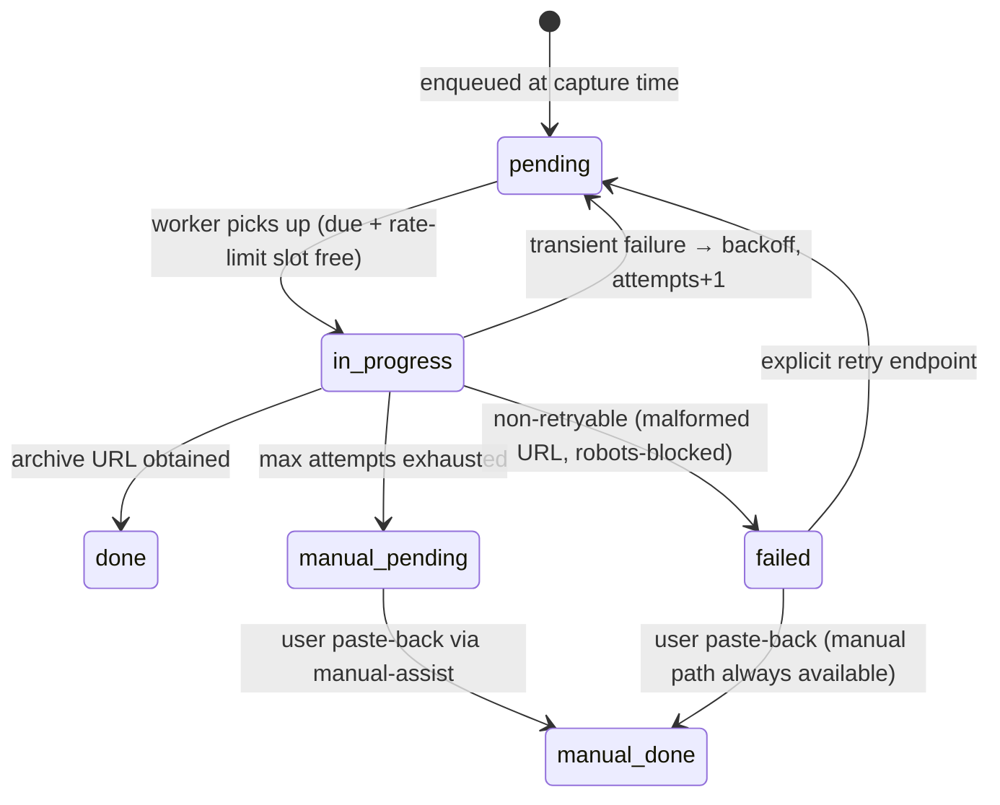
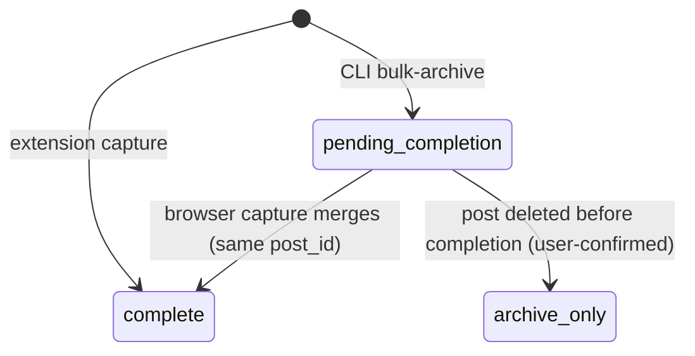

# News Integrity TR — Evidence Capture Toolkit: Architecture

**Status:** Approved design, pre-implementation.
**Audience:** Solo developer (you, six months from now).
**Scope:** MVP only — capture, tag, edge-log, archive, export. Everything else is v2 backlog (see `PLAN.md`).

---

## 1. Purpose & design principles

A local-only research toolkit that documents manipulative behavior patterns of Turkish news-style X accounts. Every claim in the eventual research output must trace back to an archived, hash-verified evidence file.

Design principles, in priority order:

1. **Evidence integrity above all.** Immutable identifiers, write-once files, hashes computed at capture time, append-only history. If a shortcut weakens the evidence trail, it is not taken.
2. **No automated discovery or collection.** Every capture is an explicit user click on content the user is already viewing. The tool never crawls, scrolls, harvests, or fetches X pages on its own. This is simultaneously a platform-ToS boundary and the methodological identity of the project (behavior-focused, never identity-focused, human-attested observation).
3. **Capture must never block.** Slow or failing archive services are decoupled from the capture flow via a persistent job queue. Nothing is ever silently dropped — failures surface in a visible queue with a manual-assist path.
4. **Boring and proven.** Sync FastAPI, SQLite, vanilla TypeScript, no frameworks where a function will do. Optimized for one developer shipping in one week without mid-way rework.

---

## 2. System components



| Component | Responsibility | Explicitly NOT responsible for |
|---|---|---|
| **Content script** | Inject [Capture]/[Edge] buttons per post; extract DOM data on click; render overlay | Talking to the backend; taking screenshots; any action without a click |
| **Service worker** | `captureVisibleTab`, crop via `OffscreenCanvas`, all HTTP to the backend | Business logic; storing state beyond in-flight requests |
| **Backend (FastAPI)** | Single write path: accounts, evidence files+hashes+sidecars, edges, archive job enqueue, exports | Fetching anything from X; UI |
| **Archive worker** | Drain `archive_jobs` with per-service rate limits, backoff, escalation to manual queue | Blocking or being awaited by any request handler |
| **CLI** | Retrospective bulk archiving (user-provided URL lists), pending-list workflow, manual-assist loop, export wrappers | Direct DB writes; fetching X pages |

---

## 3. Data flows

### 3.1 Capture flow (primary path)



Failure behavior:
- **Crop fails** (bad geometry, canvas error): capture proceeds viewport-only, record flagged `crop_failed=1`. Never abort a capture over the crop.
- **Backend unreachable**: overlay shows "backend not running" with a retry button; extracted metadata stays in the overlay so nothing is retyped. No client-side persistence of failed captures in MVP (the post is still on screen; retry or re-click).
- **Duplicate captures are allowed by design.** Re-capturing the same post later creates a new evidence row with a new seq — temporal re-observation (changed follower counts, edited context) is a feature. The only dedupe is the merge rule for `pending_completion` rows (§3.3).

### 3.2 Edge flow

One-click edge logging: `[Edge]` on a post detects the interaction structure (nested quoted article → `quote`; "reposted" header → `retweet`; "Replying to @x" → `reply`) and pre-fills a mini-confirm overlay. On confirm → `POST /api/edges`.

- Source account is always the post author (rest_id available from extraction).
- Target account: x-dom.ts attempts rest_id extraction from the quoted/replied structure. If unavailable, the edge is stored with `target_account_id = NULL` and `target_handle_raw` set. **Integrity over completeness**: we never fabricate or guess a numeric ID. Unresolved edges can be resolved later when that account is captured (v2: auto-resolution).
- An edge can also be attached inline during a capture (the `edge` field of the capture meta) so quote-posts get evidence + edge in one action.

### 3.3 CLI retrospective flow (hybrid: archive now, complete in browser)

Purpose: for an account already under investigation, archive its recent posts *immediately* (deletion insurance), then attach full evidence in a same-sprint browser pass.

1. User assembles the URL list themselves (from viewing the profile — the tool does not crawl). `cli bulk-archive --handle X --urls-file urls.txt`.
2. CLI resolves the account: the handle must match an existing `accounts` row (via `current_handle` or `handle_history`), or the user supplies `--rest-id` explicitly. Evidence rows require the immutable PK; the CLI will not invent one.
3. After a confirmation prompt, backend creates one `pending_completion` evidence row per URL (seq assigned now — this reserves the filename slot; `phase` stamped from config) and enqueues wayback + archive.today jobs immediately.
4. **Completion pass:** `cli pending list` prints clickable URLs. The user opens each in Chrome and clicks [Capture] as usual. `POST /api/captures` detects an existing `pending_completion` row with the same `post_id` and **upgrades it in place** — same id, same seq, existing archive jobs kept — filling screenshot paths, hashes, DOM metadata, and flipping status to `complete`.
5. If a post was deleted before completion: `cli pending archive-only <id>` (or the API directly) transitions the row to `archive_only`. The archive link becomes the degraded visual evidence; screenshot fields stay NULL. Exports label this tier explicitly.

### 3.4 Archival flow (background, never blocks)



- Worker: single daemon thread started in FastAPI lifespan. Loop: pick due jobs (`status='pending' AND next_attempt_at <= now`), honor per-service minimum intervals, run adapter, record result.
- **URL-level short-circuit (dedupe):** before contacting a service, if any job for the same `(service, target_url)` is already `done`/`manual_done`, the worker copies its `archive_url` and completes the new job locally — no external call. Re-captures of the same post (a designed feature) therefore never trigger duplicate submissions, while per-evidence archive linkage is preserved.
- Backoff schedule: 1m → 5m → 30m → 2h; max 5 attempts (configurable).
- **Never silently dropped:** rows are never deleted; every terminal state except `done`/`manual_done` remains visible via `GET /api/archive/jobs` and `cli archive pending`.
- **Manual-assist loop** (`cli archive manual`): for each `manual_pending`/`failed` job, opens the service's submit page in the default browser (`https://archive.ph/?url=…` or `https://web.archive.org/save/<url>`), the user solves any challenge and submits, then pastes the resulting archive URL back into the CLI prompt → `POST /api/archive/jobs/{id}/manual`.

Adapters (exact response handling finalized by spike S2, see `PLAN.md`):
- **Wayback (primary):** SPN2 — `POST https://web.archive.org/save/{url}` anonymously for MVP; optional S3 API keys via env raise rate limits later. Poll job status; store `https://web.archive.org/web/{timestamp}/{url}`.
- **archive.today (best-effort):** `POST https://archive.ph/submit/` with `url=` form field; follow redirect/refresh to the archive or `/wip/` link. Any CAPTCHA/challenge HTML ⇒ failed attempt (counts toward escalation to `manual_pending`).

---

## 4. Evidence store

### 4.1 File layout

```
data/
├── news_integrity.db
└── evidence/
    └── {phase}-{account_id}/                    # phase = NIT_PHASE (VK1|VK2), e.g. VK2-1234567890123456789/
        ├── {account_id}-0001.png               # PRIMARY: crop (or viewport if crop_failed)
        ├── {account_id}-0001-viewport.png      # CONTEXT: full visible viewport (absent if crop_failed)
        ├── {account_id}-0001.json              # sidecar (write-once)
        ├── {account_id}-0002.png
        └── ...
```

Rules (also enforced by the `evidence-integrity` skill):

- **The canonical name always holds the primary evidence.** `{account_id}-{seq:04d}.png` is the crop; when cropping failed it holds the viewport instead, and the record carries `crop_failed=1`. Report writing always references the canonical name.
- **Cropped = primary report evidence; viewport = context proof.** Both are hashed independently and both appear in the manifest.
- **Write-once.** Evidence images and sidecars are never edited, renamed, moved, or deleted after creation. Corrections happen as new captures.
- **Atomic writes.** Bytes → `*.tmp` → `os.replace`. SHA-256 is computed from the in-memory bytes before writing and re-verified by reading back from disk after the rename. Mismatch ⇒ the capture request fails loudly (5xx), files are cleaned up, nothing is committed to the DB.
- Sidecar is written **once at capture completion**. CLI-created `pending_completion` rows have no files until the completion pass; the sidecar is written when the merge-upgrade fills them.

### 4.2 Sidecar schema (`schema_version: 1`)

```json
{
  "schema_version": 1,
  "evidence_id": 42,
  "account_id": "1234567890123456789",
  "seq": 1,
  "phase": "VK2",
  "post_url": "https://x.com/somehandle/status/...",
  "post_id": "1811111111111111111",
  "post_text": "…",
  "posted_at": "2026-07-14T18:03:00Z",
  "captured_at": "2026-07-15T20:11:34Z",
  "handle_at_capture": "somehandle",
  "follower_count_at_capture": 48213,
  "category": "news",
  "codes": ["H2", "E1"],
  "taxonomy_version": "1.1",
  "note": "…",
  "capture_source": "extension",
  "crop_failed": false,
  "files": {
    "primary": {"name": "1234567890123456789-0001.png", "sha256": "…"},
    "viewport": {"name": "1234567890123456789-0001-viewport.png", "sha256": "…"}
  },
  "extraction": {"rest_id_method": "react-fiber", "extractor_version": "1.0.0"}
}
```

`taxonomy_version` is **stamped server-side** from the codebook version currently seeded out of `taxonomy.json` at the moment codes are attached (ADR-017) — the extension never supplies it. The example shows **`"1.1"`**, the version shipped with the `Y` axis + `H8` (ADR-027); evidence coded earlier keeps the `"1.0"` it was stamped with, so this field is a per-row audit of *which* codebook coded each item, not a global constant.

Archive links are **not** in the sidecar — they arrive later and the sidecar is immutable. They live in `archive_jobs` and appear in exports (case-file, manifest report).

---

## 5. Database schema

SQLite. Pragmas at every connection: `journal_mode=WAL`, `foreign_keys=ON`, `busy_timeout=5000`. All timestamps are ISO-8601 UTC strings with `Z` suffix. Migrations via Alembic from day one.

```sql
-- The immutable X numeric user ID (rest_id) is the primary key EVERYWHERE.
-- Stored as TEXT: rest_ids exceed JS Number.MAX_SAFE_INTEGER and must never
-- pass through a float. Handles are display data, never keys.
CREATE TABLE accounts (
    account_id      TEXT PRIMARY KEY,             -- X rest_id, digits only
    current_handle  TEXT NOT NULL,                -- denormalized convenience, updated on change detection
    first_seen_at   TEXT NOT NULL,
    notes           TEXT,
    created_at      TEXT NOT NULL,
    updated_at      TEXT NOT NULL
);

-- Append-only and COMPLETE FROM BIRTH: account creation inserts the initial
-- handle here (detected_at = first_seen_at, evidence_id when created via a
-- capture). Afterwards, a row is inserted with the NEWLY OBSERVED handle
-- whenever it differs from accounts.current_handle (which is then updated).
-- handle_history is therefore the full dated list of every handle ever
-- observed; current_handle is denormalized convenience only, never a key.
-- Never UPDATE or DELETE here.
CREATE TABLE handle_history (
    id           INTEGER PRIMARY KEY,
    account_id   TEXT NOT NULL REFERENCES accounts(account_id),
    handle       TEXT NOT NULL,
    detected_at  TEXT NOT NULL,
    evidence_id  INTEGER REFERENCES evidence(id)  -- capture that detected it, if any
);

-- Seeded idempotently from repo-root taxonomy.json at startup (labels upserted,
-- codes never deleted — evidence references them). taxonomy.json ships WITH the
-- real codebook (no placeholders) and carries a top-level "version"; the
-- currently seeded version is what gets stamped onto evidence rows
-- (evidence.taxonomy_version) at coding time.
CREATE TABLE taxonomy_codes (
    code                      TEXT PRIMARY KEY,   -- 'H1'..'H8', 'E1'..'E7', 'I1'..'I5', 'Y1'..'Y2'
    group_prefix              TEXT NOT NULL CHECK (group_prefix IN ('H','E','I','Y')),  -- 'Y' added in v1.1 (ADR-027)
    label                     TEXT NOT NULL,
    description               TEXT,
    international_equivalent  TEXT                -- terminology mapping used by the EN report
);

-- Fixed category list, seeded from taxonomy.json alongside the codes.
-- evidence.category references this table: no free-text categories.
CREATE TABLE categories (
    key    TEXT PRIMARY KEY,                      -- 'news','magazine','agenda','viral','anonymous_news'
    label  TEXT NOT NULL                          -- Turkish display label
);

CREATE TABLE evidence (
    id                         INTEGER PRIMARY KEY,
    account_id                 TEXT NOT NULL REFERENCES accounts(account_id),
    seq                        INTEGER NOT NULL,   -- per-account, assigned at row creation
    phase                      TEXT NOT NULL CHECK (phase IN ('VK1','VK2')),  -- from NIT_PHASE at row creation
    post_url                   TEXT NOT NULL,
    post_id                    TEXT,               -- status id from URL
    post_text                  TEXT,
    posted_at                  TEXT,               -- the post's own timestamp
    captured_at                TEXT,               -- NULL while pending_completion
    handle_at_capture          TEXT,
    follower_count_at_capture  INTEGER,
    category                   TEXT REFERENCES categories(key),
    note                       TEXT,
    taxonomy_version           TEXT,               -- stamped from the seeded taxonomy version when codes are attached; NULL while pending_completion
    -- capture_source records how the ROW came into existence. Merged rows keep
    -- 'cli': ('cli' + status 'complete') unambiguously means CLI-queued,
    -- extension-completed (see ADR-023).
    capture_source             TEXT NOT NULL CHECK (capture_source IN ('extension','cli')),
    status                     TEXT NOT NULL CHECK (status IN ('complete','pending_completion','archive_only')),
    crop_failed                INTEGER NOT NULL DEFAULT 0,
    screenshot_path            TEXT,               -- primary (canonical name)
    screenshot_sha256          TEXT,
    viewport_path              TEXT,               -- NULL when crop_failed
    viewport_sha256            TEXT,
    created_at                 TEXT NOT NULL,
    UNIQUE (account_id, seq)
);

CREATE TABLE evidence_codes (
    evidence_id  INTEGER NOT NULL REFERENCES evidence(id),
    code         TEXT NOT NULL REFERENCES taxonomy_codes(code),
    PRIMARY KEY (evidence_id, code)
);

CREATE TABLE edges (
    id                 INTEGER PRIMARY KEY,
    source_account_id  TEXT NOT NULL REFERENCES accounts(account_id),
    target_account_id  TEXT REFERENCES accounts(account_id),   -- NULL if rest_id unresolvable
    target_handle_raw  TEXT,                                   -- fallback identity, never a key
    edge_type          TEXT NOT NULL CHECK (edge_type IN ('quote','retweet','reply','mention')),
    phase              TEXT NOT NULL CHECK (phase IN ('VK1','VK2')),  -- from NIT_PHASE at row creation
    post_url           TEXT NOT NULL,
    observed_at        TEXT NOT NULL,
    evidence_id        INTEGER REFERENCES evidence(id),        -- when logged inline with a capture
    note               TEXT
);

-- Rows are never deleted; status transitions only (see state diagram in §3.4).
CREATE TABLE archive_jobs (
    id               INTEGER PRIMARY KEY,
    evidence_id      INTEGER NOT NULL REFERENCES evidence(id),
    service          TEXT NOT NULL CHECK (service IN ('wayback','archive_today')),
    target_url       TEXT NOT NULL,
    status           TEXT NOT NULL CHECK (status IN
                     ('pending','in_progress','done','failed','manual_pending','manual_done')),
    attempts         INTEGER NOT NULL DEFAULT 0,
    next_attempt_at  TEXT,
    archive_url      TEXT,
    last_error       TEXT,
    created_at       TEXT NOT NULL,
    updated_at       TEXT NOT NULL
);
CREATE INDEX idx_archive_jobs_due ON archive_jobs (status, next_attempt_at);
CREATE INDEX idx_evidence_post_id ON evidence (post_id);
CREATE INDEX idx_edges_source ON edges (source_account_id);
```

Evidence status lifecycle:



---

## 6. API contract

FastAPI, **bound to 127.0.0.1 only**, default port **8765**. No auth (localhost, single user — the binding is the security boundary). CORS: locked to the installed extension's own origin — `allow_origins = ["chrome-extension://{NIT_EXTENSION_ID}"]`. When `NIT_EXTENSION_ID` is unset (first run, before the unpacked extension has an ID), the backend falls back to `allow_origin_regex = ^chrome-extension://.*$` and logs a prominent startup warning telling the user to pin the ID (README setup step). Errors use FastAPI's standard `{"detail": ...}` shape with appropriate 4xx/5xx codes.

| Method & path | Body / params | Returns | Notes |
|---|---|---|---|
| `GET /healthz` | — | `{status, version, data_dir}` | Extension pings this to distinguish "backend down" from other failures |
| `GET /api/taxonomy` | — | `{version, groups: {H, E, I}, categories: [{key, label}], codes: [{code, group_prefix, label, description, international_equivalent}]}` | Feeds the overlay checkboxes + category select; `version` is the stamp source for `evidence.taxonomy_version` |
| `POST /api/captures` | multipart: `meta` (JSON), `viewport` (PNG), `crop` (PNG, optional) | `201 {evidence_id, seq, screenshot_sha256, viewport_sha256, merged}` | The main write path; see below |
| `POST /api/edges` | `{source: {rest_id, handle}, target: {rest_id?, handle}, edge_type, post_url, note?}` | `201 {edge_id, target_resolved}` | Creates source (and target if rest_id present) accounts as needed |
| `GET /api/accounts` | `?handle=` optional filter | list | Lookup, incl. match against handle_history |
| `GET /api/accounts/{account_id}` | — | account + handle_history | |
| `GET /api/pending` | `?post_id=` optional | `pending_completion` rows | The completion-pass worklist |
| `POST /api/evidence/{id}/archive-only` | `{note?}` | updated row | Only valid from `pending_completion`; deleted-post degrade |
| `GET /api/archive/jobs` | `?status=` | job rows | The visible queue — includes `manual_pending` and `failed` |
| `POST /api/archive/jobs/{id}/retry` | — | job row | `failed`/`manual_pending` → `pending`, attempts reset |
| `POST /api/archive/jobs/{id}/manual` | `{archive_url}` | job row | Paste-back → `manual_done` |
| `POST /api/cli/bulk-archive` | `{account: {handle, rest_id?}, urls: [..]}` | `{created: [{evidence_id, seq, post_url}], skipped: [..]}` | Account must exist or rest_id supplied; URLs validated as `x.com|twitter.com /status/` links; handle-mismatch URLs go to `skipped` with reason |
| `GET /api/exports/edges.csv` | — | CSV | `source_account_id, source_handle, target_account_id, target_handle, edge_type, phase, post_url, observed_at, evidence_id` |
| `GET /api/exports/accounts/{account_id}/case-file.json` | — | JSON | Account + full handle_history + all evidence (codes, taxonomy_version, phase, hashes, archive links, status/tier) + all edges touching the account |
| `GET /api/exports/manifest` | `?verify=true` | JSON | All evidence files + sidecars with SHA-256; `verify=true` recomputes from disk and reports mismatches per file |

`POST /api/captures` — `meta` JSON shape:

```json
{
  "post_url": "…", "post_id": "…", "post_text": "…", "posted_at": "…",
  "author": {"rest_id": "…", "handle": "…", "follower_count": 48213},
  "category": "…", "codes": ["H2","E1"], "note": "…",
  "crop_failed": false,
  "edge": {"target_rest_id": null, "target_handle": "…", "edge_type": "quote"}
}
```

Server-side sequence (single transaction around the DB work):
1. Upsert account by `rest_id`; on first creation, insert the initial handle into `handle_history` as well; if an observed handle ≠ `current_handle`, append the newly observed handle to `handle_history` and update `current_handle`.
2. **Merge check:** if a `pending_completion` evidence row exists with the same `post_id` → upgrade that row in place (keep `id`, `seq`, `phase`, `capture_source='cli'`, existing `archive_jobs`); else assign `seq = MAX(seq)+1` for the account and insert with `phase` from config.
3. Write files atomically, compute + re-verify SHA-256, write sidecar.
4. Insert `evidence_codes` (validated against `taxonomy_codes`), validate `category` against `categories`, stamp `evidence.taxonomy_version` from the currently seeded taxonomy version; optional inline edge (stamped with `phase`).
5. Enqueue `archive_jobs` for both services (skip when merging — jobs already exist).

Manifest format:

```json
{
  "generated_at": "…",
  "verified": true,
  "entries": [
    {"path": "evidence/VK2-…/…-0001.png", "sha256": "…", "evidence_id": 42,
     "role": "primary", "status": "complete", "phase": "VK2", "verify": "ok"}
  ],
  "mismatches": []
}
```

---

## 7. Extension ↔ backend communication model

**Why the service worker mediates everything:** content scripts run inside x.com's page context, where X's CSP/CORS would interfere with `fetch` to `http://127.0.0.1:8765`. The MV3 service worker fetches with extension host permissions instead. Content script ↔ SW messaging carries **metadata only** (small JSON); the screenshot never transits messaging because the SW captures it itself.

Message protocol (`chrome.runtime.sendMessage`, request/response):

| Type | Direction | Payload | Response |
|---|---|---|---|
| `CAPTURE_REQUEST` | overlay → SW | `{meta, rect: {x,y,w,h}, dpr}` | `{ok, evidence_id?, seq?, merged?, error?}` |
| `EDGE_REQUEST` | overlay → SW | edge body (as in `POST /api/edges`) | `{ok, edge_id?, target_resolved?, error?}` |
| `TAXONOMY_GET` | content → SW | — | `{ok, taxonomy?}` — full `{version, groups, categories, codes}` payload (SW proxies `GET /api/taxonomy`, caches per session) |
| `HEALTH_CHECK` | content → SW | — | `{ok, backendUp}` |

Screenshot pipeline in the SW: `chrome.tabs.captureVisibleTab(format: "png")` → `createImageBitmap` → `OffscreenCanvas` crop using `rect × dpr` (rect is viewport-relative, exactly what `getBoundingClientRect()` returns) → two PNG blobs → one multipart `POST /api/captures`. Any crop-stage exception downgrades to viewport-only + `crop_failed: true` rather than failing the capture.

Manifest (conceptual):

```jsonc
{
  "manifest_version": 3,
  "host_permissions": ["https://x.com/*", "https://twitter.com/*", "http://127.0.0.1:8765/*"],
  "content_scripts": [{ "matches": ["https://x.com/*", "https://twitter.com/*"], "js": ["content.js"] }],
  "background": { "service_worker": "background.js" }
  // No action popup in MVP. No storage of captured data in the extension.
}
```

Overlay: a container element appended to `document.body` with an **open Shadow DOM** (open for debuggability; isolation comes from the shadow boundary either way). All overlay CSS lives inside the shadow root; X's styles cannot leak in, ours cannot leak out.

`x-dom.ts` contract (see the `x-dom-extraction` skill): every selector and the React-fiber walk live only in this module; every extractor returns `{value, method} | null` and **fails soft** — a capture with a missing follower count is still a capture (field NULL, method recorded in the sidecar's `extraction` block).

---

## 8. CLI companion

Typer app, thin `httpx` client. Requires the backend to be running — the backend is the **single write path** (this is deliberate: one SQLite writer process, one place where invariants are enforced).

```
cli bulk-archive --handle <h> [--rest-id <id>] --urls-file <f>   # confirm prompt, then create pending rows + jobs
cli pending list                                                  # completion-pass worklist, clickable URLs
cli pending archive-only <evidence_id>                            # deleted-post degrade
cli archive pending                                               # show manual_pending + failed jobs
cli archive manual                                                # assist loop: open submit page → paste link back
cli export edges|case-file <account_id>|manifest [--verify]       # wrappers around export endpoints
```

The CLI never fetches X. The user assembles URL lists by hand; the archive services do the fetching.

---

## 9. Configuration

`pydantic-settings`, `.env` in `backend/`:

| Variable | Default | Purpose |
|---|---|---|
| `NIT_DATA_DIR` | `./data` | DB + evidence root |
| `NIT_PORT` | `8765` | Bind port (host is hardcoded `127.0.0.1`) |
| `NIT_PHASE` | `VK1` | Current case-study phase (`VK1`\|`VK2`); stamped onto every evidence and edge row at creation and used as the evidence folder prefix. Switched to `VK2` once, at the start of sprint S2 |
| `NIT_EXTENSION_ID` | unset | Installed extension's ID; when set, CORS is locked to exactly that origin (prominent startup warning while unset) |
| `NIT_ARCHIVE_MAX_ATTEMPTS` | `5` | Per job before escalation |
| `NIT_ARCHIVE_TODAY_MIN_INTERVAL_S` | `45` | Min seconds between archive.today submissions |
| `NIT_WAYBACK_MIN_INTERVAL_S` | `60` | Min seconds between Wayback submissions |
| `NIT_WAYBACK_S3_ACCESS` / `NIT_WAYBACK_S3_SECRET` | unset | Optional SPN2 auth (higher limits) |

---

## 10. Boundaries this architecture enforces

- **ToS / methodology:** no code path fetches X content except the user's own browser rendering what the user is viewing. Extraction handlers run only inside click handlers. The MutationObserver only decorates UI.
- **Identity discipline:** the immutable numeric `rest_id` is the only key; handles are observations with detection dates (complete from account creation). Behavior is documented; identity is never inferred.
- **Methodological provenance:** every evidence and edge row records the case-study phase (`VK1`/`VK2`) it belongs to, and every coded evidence row records the taxonomy version it was coded under. Exports carry both, so any claim traces back to its phase and its codebook.
- **Evidence tiers are explicit:** `complete` (screenshot + hashes + archives) > `archive_only` (archives only, degraded, labeled in every export). No export ever silently mixes tiers.
- **Out of scope for MVP** (see `PLAN.md` v2 backlog): GraphQL/XHR interception, dashboards, settings UI, auth, multi-user, media capture, Firefox.
